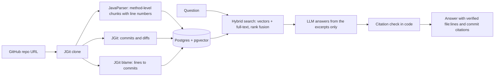

# Codebase Time Machine

**Ask where code lives and why it changed.** Point it at a public GitHub repo, then ask questions like *"Where is a new owner saved, and why was it written this way?"* Every file, line range and commit in the answer is checked in code against what was actually retrieved. If the history never recorded a reason, the answer says so instead of guessing.

I built it as a RAG project in Java: Spring Boot, Spring AI, Postgres with pgvector, JGit and JavaParser, with a React frontend.

<!-- Add a screenshot or GIF of the UI here: docs/demo.png -->

## What it does

- **Finds code.** Returns file names and line numbers, with a short explanation of what the code does.
- **Explains history.** Answers questions about commits, authors and dates, and filters by file, author or date range.
- **Links the two.** Uses `git blame` to attach each code chunk to the commits that last changed its lines, so one answer covers *where*, *what* and *why*.
- **Refuses to guess.** Citations that were not in the retrieved excerpts are removed. If no commit message states a reason, the answer says "not recorded in the commit messages".

### Example (condensed from a real run on spring-petclinic)

> **Q:** Where is a new owner saved, and why was it written this way?
>
> **Where:** `src/main/java/.../owner/OwnerController.java`, lines 77-87
> **What it does:** validates the `Owner`, saves it with `this.owners.save(owner)`, then redirects.
> **Why:** not recorded in the commit messages. The commits that last changed these lines describe what changed but give no explicit reason.
>
> 0 citations rejected.

## How it works



1. **Chunking.** Java files are cut at method and constructor boundaries with JavaParser. Other text files use 40-line windows with a 10-line overlap. Every chunk stores its file path and line range, and the chunk text is copied from the original file lines so the numbers stay true.
2. **Embeddings.** `all-MiniLM-L6-v2` (384 dimensions) runs locally through ONNX, with no API key and no token cost.
3. **Search.** Vector search (pgvector, cosine) and keyword search (Postgres full-text, with camelCase split into words) are merged with reciprocal rank fusion. Test files and non-code chunks (SQL, HTML, docs, config) count half unless the question asks for them.
4. **History.** JGit reads commits (merge commits skipped) with author, date, message, files changed and line counts.
5. **Blame.** JGit blame with whitespace changes ignored maps each chunk's lines to the commits that last changed them.
6. **Answering.** The LLM sees about 6 short excerpts and must cite them by tag. The server then deletes any citation that does not match an excerpt it was sent.

## Design decisions

- **The model never produces line numbers on its own.** Line ranges come from stored chunk metadata, and every citation is verified before it is shown. On the indexed spring-petclinic data, `/verify` re-read all 298 chunks from disk and found 0 line-range mismatches.
- **"What" and "why" are kept separate.** Commit messages usually describe the change, not the reason. The code flags messages that are too short, generic or without reason words, and the model must report those as "not recorded". An early version passed a commit subject off as the reason, which is why this check exists.
- **When an answer was wrong, I checked retrieval before blaming the model.** For "Where is a new owner saved?", the right method was missing from the 4 chunks the model saw, so it answered from the update method. Stripping the "why ..." part from the search query and sending 6 smaller chunks instead of 4 larger ones fixed it, and the correct method now appears in the sources.
- **Model output formatting is not trusted.** Models sometimes wrote non-breaking hyphens, fullwidth brackets or doubled brackets around citations, so answers are normalized before verification.
- **Embedding model files load from disk.** The default setup downloaded about 90 MB from GitHub on every start, and one start failed on a network timeout. The app now reads the files from `models/`.

## Evaluation

I measured retrieval only (not answer quality). A question counts as correct if the expected method (file path and name) appears in the top K results. Recall@K is the share of questions where it does, and MRR is the mean of 1/rank.

| Set | Repo | Questions | Role |
|---|---|---|---|
| Development | spring-petclinic | 22 (14 LLM-drafted and reviewed, 8 written by hand) | Used to find problems and choose the fix |
| Hold-out | spring-petclinic | 10, written by hand with an AI assistant's help | Used for one comparison, after the fix was chosen |
| Second repo | this project | 8 LLM-drafted | Sanity check |

**spring-petclinic, hold-out (10 questions)**

| Method | Recall@1 | Recall@3 | Recall@5 | MRR |
|---|---|---|---|---|
| Vector only | 0.40 | 0.50 | 0.70 | 0.51 |
| Keyword only | 0.00 | 0.00 | 0.00 | 0.00 |
| Hybrid, baseline | 0.20 | 0.30 | 0.50 | 0.33 |
| **Hybrid, final** | **0.30** | **0.60** | **0.80** | **0.51** |

**spring-petclinic, development set (22 questions)**

| Method | Recall@1 | Recall@3 | Recall@5 | MRR |
|---|---|---|---|---|
| Vector only | 0.41 | 0.50 | 0.77 | 0.51 |
| Keyword only | 0.05 | 0.32 | 0.45 | 0.20 |
| Hybrid, baseline | 0.41 | 0.55 | 0.64 | 0.53 |
| **Hybrid, final** | **0.50** | **0.73** | **0.86** | **0.62** |

**This repository (8 questions)**

| Method | Recall@1 | Recall@3 | Recall@5 | MRR |
|---|---|---|---|---|
| Vector only | 0.38 | 0.63 | 0.63 | 0.56 |
| Keyword only | 0.13 | 0.50 | 0.63 | 0.37 |
| Hybrid, baseline | 0.50 | 0.75 | 0.88 | 0.66 |
| **Hybrid, final** | **0.50** | **0.75** | **0.88** | **0.67** |

"Baseline" is hybrid search with the test-file penalty only. "Final" also halves the weight of non-code chunks.

### Findings

- **Keyword-only search was the weakest method on every set.** It found the right method first in at most 13% of questions.
- **The baseline hybrid was not better than vector-only on petclinic.** Its misses were mostly SQL, HTML and README chunks outranking the right Java method.
- **Down-weighting non-code chunks** (factor 0.5, adopted by a rule I set before running the hold-out) raised hold-out Recall@5 from 0.50 to 0.80 and MRR from 0.33 to 0.51. That matches vector-only (0.70 and 0.51), so I do not claim it beats it. It made no difference on this repository's questions.
- **Lowering the keyword weight** (0.5, 0.25, 0.1) helped petclinic but lowered MRR on this repository, so I did not adopt it.
- The development-set gains are optimistic, because the misses that suggested the fix came from those questions. The hold-out is the number to trust, and it has only 10 questions.

## Tech stack

| Layer | Choice |
|---|---|
| Backend | Java 21, Spring Boot 4.0.8, Spring AI 2.0.0 |
| Database | PostgreSQL 16 with pgvector (`pgvector/pgvector:pg16`), full-text search (`tsvector`) |
| Embeddings | `all-MiniLM-L6-v2` via ONNX, local |
| LLM | Groq, `openai/gpt-oss-120b` |
| Git and code analysis | JGit 7.6.0, JavaParser 3.28.2 |
| Frontend | React, TypeScript, Vite |

## Run it locally

You need Java 21+, Docker, Node.js, and a free [Groq](https://console.groq.com) API key.

**1. Database**
```bash
docker run -d --name pg -e POSTGRES_PASSWORD=pass -p 5432:5432 pgvector/pgvector:pg16
```
The password is for a local container only. `schema.sql` creates the tables at startup.

**2. Embedding model files** (one-time download, about 90 MB, not stored in git)
```bash
mkdir -p models/all-MiniLM-L6-v2
curl -L -o models/all-MiniLM-L6-v2/tokenizer.json https://raw.githubusercontent.com/spring-projects/spring-ai/main/models/spring-ai-transformers/src/main/resources/onnx/all-MiniLM-L6-v2/tokenizer.json
curl -L -o models/all-MiniLM-L6-v2/model.onnx https://media.githubusercontent.com/media/spring-projects/spring-ai/refs/heads/main/models/spring-ai-transformers/src/main/resources/onnx/all-MiniLM-L6-v2/model.onnx
```
`model.onnx` should be about 90 MB. A file of a few hundred bytes is a placeholder, so download it again.

**3. Groq key** (never commit it)
```bash
export GROQ_API_KEY="your-key"        # macOS / Linux
setx GROQ_API_KEY "your-key"          # Windows, then reopen the terminal
```

**4. Backend** (runs on port 8081)
```bash
./mvnw spring-boot:run                # Windows: .\mvnw.cmd spring-boot:run
```

**5. Frontend**
```bash
cd frontend
npm install
npm run dev                           # http://localhost:5173
```
Paste a GitHub URL and press **Index it**. It runs the three indexing steps (code, history, blame) in order. Then ask a question in **Code + why** or **History** mode, and click any citation chip to see the cited lines highlighted or the full commit message.

<details>
<summary>Key settings in <code>application.properties</code></summary>

```properties
server.port=8081
spring.sql.init.mode=always
spring.datasource.url=jdbc:postgresql://localhost:5432/postgres
spring.datasource.username=postgres
spring.datasource.password=pass

spring.ai.openai.api-key=${GROQ_API_KEY}
spring.ai.openai.base-url=https://api.groq.com/openai/v1
spring.ai.openai.chat.model=openai/gpt-oss-120b

spring.ai.model.embedding=transformers
spring.ai.embedding.transformer.onnx.model-uri=file:models/all-MiniLM-L6-v2/model.onnx
spring.ai.embedding.transformer.tokenizer.uri=file:models/all-MiniLM-L6-v2/tokenizer.json
```
</details>

## API

| Endpoint | Purpose |
|---|---|
| `POST /index` | Clone a public GitHub repo and index its code chunks and embeddings |
| `POST /index-history` | Read commits (default 500, merges skipped) and embed them |
| `POST /index-blame` | Link each code chunk to the commits that last changed its lines |
| `POST /ask-full` | Answer with where, what and why, with code and commit citations |
| `POST /ask-code` | Code-only answer with file and line citations |
| `POST /ask-history` | History answer with commit citations; filters by author, date range, file |
| `GET /search` | Raw retrieval; `mode` is `vector`, `keyword` or `hybrid` |
| `GET /blame`, `/commits`, `/commit`, `/file`, `/repos`, `/verify` | Data for the UI and for checking results |
| `POST /ask` | Plain LLM chat with no retrieval, kept as the "before RAG" baseline |
| `/eval/*` | Evaluation harness: generate or add cases, run the retrieval exam |

`/file` serves only files that exist in the index and rejects paths outside the repo folder.

## Project structure

```
src/main/java/com/timemachine/codebase_time_machine/
  RepoCloner, CodeChunker, IndexService      clone, chunk, store
  EmbeddingService, SearchService            embeddings and hybrid search
  AnswerService, FullAnswerService           grounded answers with citation checks
  HistoryReader, HistoryService,
  HistorySearchService, HistoryAnswerService commit history
  BlameService                               git blame to chunk links
  EvalService, EvalController                retrieval evaluation
  *Controller, ApiErrors, WebConfig          HTTP layer
src/main/resources/schema.sql                tables and indexes
frontend/                                    React + TypeScript UI
```

## Limitations

- **Retrieval is measured; answer quality is not yet.** An end-to-end answer evaluation endpoint exists, but I have not run it or reported results.
- **Small samples.** One question moves a score by 4 to 12 points, and only two repositories were tested.
- **The questions were not written blind.** Most were drafted by an LLM from the code, and the hold-out questions were written with an AI assistant's help after I had the method list.
- **The metric is strict.** It counts a relevant HTML template as a miss when the expected answer is a Java method.
- **"Why" is only as good as the commit messages.** Blame shows who last touched a line, not who first had the idea.
- **Keyword search is basic.** It matches any word in the question and does not weight rare words, so it scored 0 of 10 on the hold-out.
- **Free-tier limits.** The Groq models on my account allow about 8K tokens per minute, so each question sends about 3K tokens.
- **Scope.** Public GitHub repos only. Java gets method-level chunking, and other text files use fixed windows. No authentication or rate limiting yet.

## Roadmap

- Docker image with the embedding model baked in, plus hosted backend, database and frontend
- Rate limiting, and removing the temporary `debugRaw` field from responses
- Switching off the `/eval/*` endpoints in public deployments
- End-to-end answer evaluation
- A keyword search that weights rare terms
